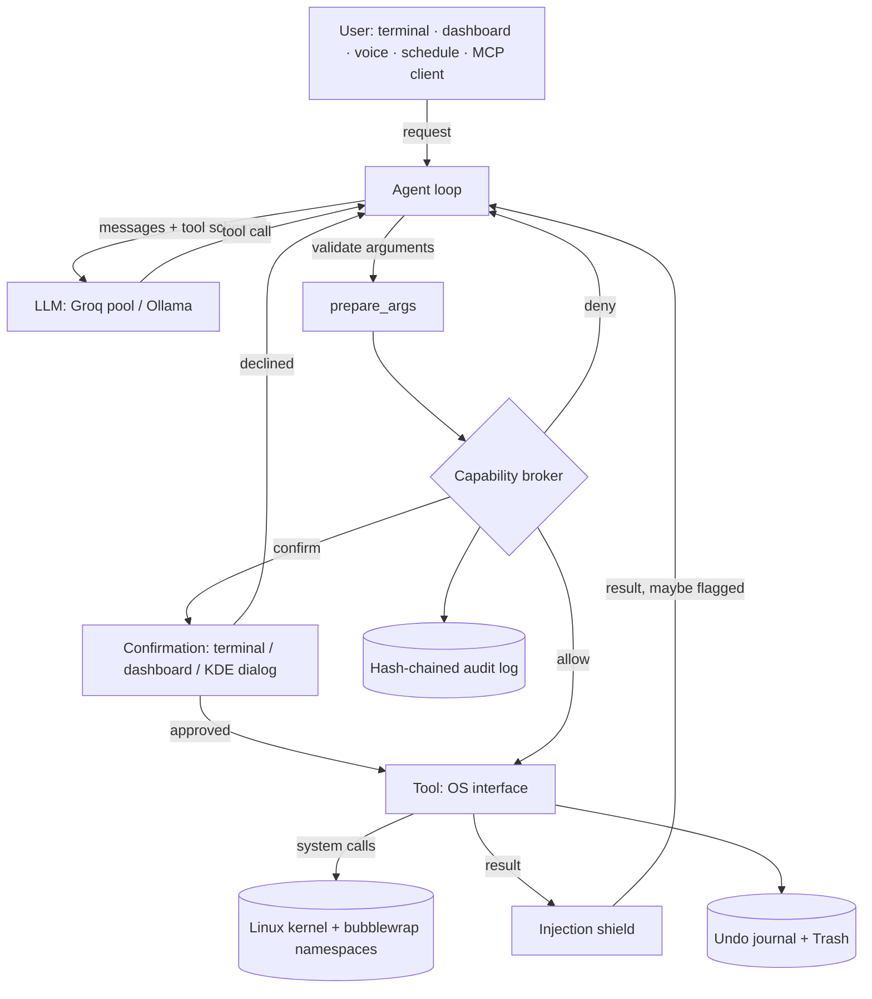
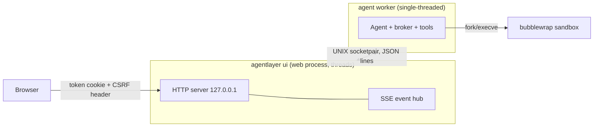

# Architecture

AgentLayer is a closed **request → plan → check → execute → observe** loop. The language model only ever
*proposes* actions; everything that touches the operating system goes through one reference monitor, the
capability broker.

## Components

| Module | Responsibility |
|---|---|
| `agent.py` | The loop; tool groups (core + on-demand); confirmation handling ("always for this request", human-only checks); dry-run; taint after a flagged result; context fitting to the model's token limit; memory-claim check. |
| `broker.py` | Turns tool requirements into one decision (allow / confirm / deny). Holds the invariants and the expiring temporary grants. |
| `policy.py` | Loads and validates TOML policies; canonicalises path globs; the access matrix. |
| `tools/*` | 38 tools. Each declares `requires` (what it needs), `run` (the system calls), optional `preview` (what a confirmation shows), plus metadata: group, whether it changes state, whether its output is untrusted, and which syscalls it uses. |
| `safeio.py` | Race-free access to broker-approved paths with `openat` walks and `O_NOFOLLOW`. |
| `executor.py` | `fork`/`execve`/`wait4` pipelines with pipes, `setsid`, rlimits, deadlines, live output. |
| `sandbox.py` | bubblewrap argument builder: namespaces, read-only system, workspace and granted folders, masks. |
| `journal.py` | Undo journal (backups, append lengths, moves, copies, folders) and the freedesktop Trash. |
| `guard.py` | Injection shield: patterns → Llama Prompt Guard 2 → gpt-oss-safeguard policy check. |
| `llm.py`, `quota.py` | Groq backend (key pool, pacing, model fallback, local fallback, vision, guard, Whisper), Ollama, OpenAI-compatible. |
| `session.py` | Builds a runtime (policy, sandbox, broker, stores, model, guard) identically for every front end. |
| `audit.py`, `memory.py`, `scheduler.py`, `monitor.py`, `desktop.py`, `inotify.py`, `procfs.py` | Journals and stores, systemd timers, live metrics, desktop integration, kernel interfaces. |
| `cli.py`, `ui.py`, `web/`, `mcp.py`, `evals.py` | Front ends and the evaluation harness. |

## The life of one tool call

1. The model returns `write_file(path="notes.txt", content=…)`.
2. `prepare_args` validates and coerces the arguments (nulls → defaults, `"10"` → 10).
3. The tool's `requires` resolves `notes.txt` to a canonical path (`realpath`) and declares
   `Requirement(fs.write, path=/home/u/agentlayer-workspace/notes.txt, overwrite=True)`.
4. The broker checks deny rules (against the requested *and* the resolved path), invariants (trusted
   computing base, workspace root), grants (static and temporary) and returns **confirm** (overwrite).
5. If the request was tainted by a flagged result, an *allow* for a state-changing tool is raised to *confirm*.
6. The confirmation shows a unified diff; the person approves.
7. `run` backs up the old file into the undo journal, opens the approved path with an `openat` walk and
   `O_NOFOLLOW`, writes, `fsync`s, and records the change.
8. The decision and outcome are appended to the audit log (hash-chained, `fsync`'d).
9. The result goes back to the model, after the injection shield if the tool's output is untrusted.

## Processes and IPC

* The dashboard forks its worker **before** starting any thread, because `fork()` in a multi-threaded
  process is unsafe; the worker stays single-threaded, so its own fork/exec of commands is safe.
* The web process never runs tools on the agent's behalf (privilege separation). It reads metrics, the audit
  log and the stores directly.
* The MCP server is a single-threaded stdio JSON-RPC loop; approvals use `kdialog` on the desktop.
* Scheduled tasks are separate processes started by systemd (`agentlayer task-run NAME`).

## Files on disk

| Path | Format | Notes |
|---|---|---|
| `~/.local/state/agentlayer/audit.jsonl` | JSON lines with `prev`/`hash` | `flock` for concurrent writers, `fsync` per record |
| `~/.local/state/agentlayer/undo/` | `journal.json` + backup blobs | pruned to the last 300 changes |
| `~/.local/share/Trash/{files,info}` | freedesktop Trash spec | restorable by Dolphin too |
| `~/.local/state/agentlayer/memory.json`, `sessions/*.json` | JSON | atomic replace, mode 0600 |
| `~/.local/state/agentlayer/groq-quota.json` | JSON | key fingerprints only, never keys |
| `~/.local/state/agentlayer/tasks/*.json`, `*.log` | JSON, text | plus `~/.config/systemd/user/agentlayer-task-*.{service,timer}` |
| `~/agentlayer-workspace/` | — | the agent's working directory |

## Token economy

Hosted models have small per-request limits (7–8K tokens per minute per organisation on the free tiers).
AgentLayer keeps requests small: only the core tool group (13 tools) is sent by default and other groups load
when the request mentions them or the model asks; results are capped; older results are shortened and older
turns dropped to fit the tightest limit among the fallback models (learned from Groq's errors); reasoning
models run with low effort.
